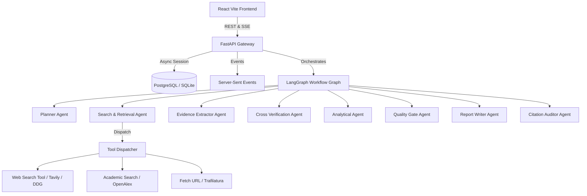

# ResAI Architecture Specification

ResAI is an evidence-driven, autonomous research assistant designed to deliver auditable research reports with 100% verified citations, zero unreferenced factual assertions, and explicit cross-source contradiction resolution.

## System Components

## State Machine Stages

1. **Research Intake**: Validates inputs, mode selection, recency, file uploads.
2. **Research Planner Agent**: Generates structured Pydantic plan with subquestions and search queries.
3. **Plan Approval**: Human-in-the-loop review. User can Approve & Start, Edit, or Regenerate with feedback.
4. **Search and Retrieval Agent**: Executes tool calls (`web_search`, `search_academic_sources`), normalizes canonical URLs, deduplicates.
5. **Evidence Extraction Agent**: Extracts claim records, quotes, dates, confidence scores, and relationships.
6. **Cross-Source Verification Agent**: Identifies contradictions and single-source warnings.
7. **Analytical Agent**: Builds comparison matrices, calculates stats (pandas/numpy), prepares chart configurations.
8. **Research Quality Gate**: Bounded loop evaluation checking completion criteria vs run budget.
9. **Report Writer Agent**: Synthesizes report in Markdown with in-text numeric citations `[1]`, `[2]`.
10. **Citation Audit & Finalization**: Verifies references in DB, flags unsupported claims, records ReportVersion.
